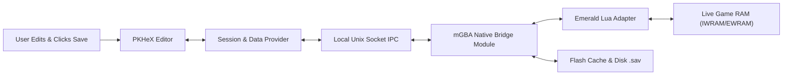
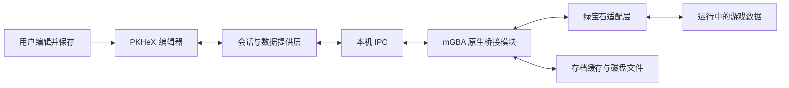

# Seamless Real-Time GBA Save Editor Architecture / 口袋妖怪 GBA 无感实时修改器设计

**[English](#english) | [中文说明](#中文说明)**

---

<a id="english"></a>

## English

- **Version**: v1.4
- **Target Environment**: macOS (Apple Silicon), PKHeX-Avalonia, mGBA 0.10.5, Pokémon Emerald (`BPEE`, including the 2011 Chinese 386 ROM hack, CRC32 `ad89a894`, SHA-256 `af821cf6f017b41241f2be73fe9bba34a1e411fdc3da235e333bd0890b9b3195`).

### 1. Goals & Completion Criteria

Users open a single application to continue playing, inspect current trainer/bag/Pokémon state, edit fields, and click **Save**. Emulator launch, game recognition, IPC connection, live snapshot loading, 3-way synchronization, reconnection, and exit cleanup happen automatically with **zero manual bridge setup operations**.

- Single app entry point launches both the editor and the embedded companion emulator (`mGBA实时版.app`), restoring the most recent game via macOS security-scoped bookmarks.
- Automatic discovery and attachment regardless of launch order.
- Clean workspace fields refresh automatically from live emulator snapshots; active user inputs and unapplied sub-panel drafts are preserved.
- Clicking **Save** performs a 3-way merge against the latest live snapshot, prompts on true field-level conflicts, and atomically commits to GBA RAM, Flash, and the `.sav` file on disk.
- Resetting, loading a savestate, rewinding, or switching games invalidates stale transactions and archives pending drafts.

### 2. System Architecture

#### 2.1 Application Bundle Layout

```text
PKHeX实时版预览.app/
  Contents/
    MacOS/
      PKHeX.Avalonia
    Helpers/
      mGBA实时版.app/
    Resources/
      GBABridge/
        mgba_bridge.lua
        save_commit.lua
        build-info.json
      Licenses/
```

#### 2.2 Component Responsibilities

| Component | Responsibility |
| --- | --- |
| **Live Session Manager (`AutoLiveWorkspace`)** | Discovers running sessions, manages security-scoped bookmarks, schedules snapshots, and coordinates UI refreshes |
| **3-Way Merge Engine (`LiveMerge` / `SaveCodec`)** | Decodes save sections and Pokémon substructures, tracks dynamic XOR encryption keys and unique Pokémon identities (`PID + ID32`), and performs field-level 3-way rebasing |
| **Coordinated Save Service (`SaveCommitCoordinator`)** | Manages cross-process file lock leases, stable transaction journals, lost-receipt recovery, and atomic live commits |
| **mGBA Native Bridge (`LiveBridge.cpp`)** | Manages length-prefixed JSON over Unix Domain Sockets (`/tmp/pkx-<uid>/<id>.sock`), holds `CoreController::Interrupter` during script calls, and publishes session manifests |
| **Emerald Lua Adapter (`mgba_bridge.lua` & `save_commit.lua`)** | Validates overworld readiness (`0x030022C0 == 0x08085E05`), verifies `GUARDALL` and save counter (`0x03006200`), patches RAM, schedules `gTasks` Bag redraws, and atomically rebinds Flash/disk save backends |
| **Chinese Codec (`ChineseCodec.cs`)** | Encodes and decodes 6,767 double-byte Chinese characters for trainer names, nicknames, and OT names |



### 3. Local IPC & Timeline Tracking

- **Discovery**: Each `mGBA` instance creates a `0700` user-owned socket directory `/tmp/pkx-<uid>/` and atomically publishes a `0600` session manifest JSON under `~/Library/Application Support/PKHeX-Avalonia/GBABridge/sessions/<instanceId>.json` containing a random per-session authentication token, PID, ROM SHA-256, and canonical `.sav` path.
- **Timeline Identity**: Every transaction binds `(session, epoch)`. Emulation `reset`, `stateLoaded`, `start`, `stop`, frame rewind (`currentFrame < lastFrame`), or Trainer ID change increments `epoch`, causing stale transactions to return `STALE` before touching memory.

### 4. 3-Way Field Merging & Conflict Resolution

Three images are maintained:
1. **Baseline**: Consistent snapshot when editing began (or after the last clean rebase).
2. **Draft**: User's current workspace state.
3. **Live Snapshot**: Latest consistent snapshot from the emulator (`SNAPLIVE`).

Merge rules per semantic field:
1. `Draft == Baseline` → Adopt `Live` value (clean field auto-refresh).
2. `Live == Baseline` → Adopt `Draft` value (clean user edit).
3. `Live == Draft` → Treat as already applied.
4. `Draft != Baseline` and `Live != Baseline` and `Draft != Live` → Raise a field-level conflict (`LiveFieldConflict`) with human-readable Baseline, Live Game, and Edited values.
5. **Party & Box Slot Identity Tracking**:
   - When the game reorders party slots while the user edits a Pokémon in place, the edit follows the Pokémon's unique `(PID, ID32)` to its new live slot.
   - When the user swaps or moves Pokémon across party or box slots in the editor, `SaveCodec.Rebase` matches the moved Pokémon against its original baseline slot and current live slot to merge field edits while preserving live battle HP/PP.
6. **Active Save Bank Rotation (`LiveBank`)**:
   - `SAV3` caches its active save bank (`0` or `1`) in a readonly field. When an in-game save rotates the active bank, `RefreshLiveImage` reconstructs the `SAV3E` instance via `_saveFileService.OpenLoadedSave` while restoring the active workspace tab, selected inventory pouch, current PC box index (`CurrentBox` & `SelectedIndex`), Event Flag filter/selection, and active Pokémon editor target without dirtying `save.CurrentBox`.

### 5. Coordinated Save & Savestate Flash Rollback

1. The editor acquires the cross-process save lease and requests `SNAPLIVE` (which returns `SMALL`, `LARGE`, `BOXES`, `PARTY`, `FLASH` via `emu:saveStateBuffer(2)`, `COUNTER` at `0x03006200`, and `DISKBYTES`).
2. If `SaveCodec.Parse(FLASH).Counter != COUNTER`, an in-game Flash write is in progress and the commit waits.
3. `SaveCodec.Image` encodes all 14 save sections into the active bank(s), updates section checksums, and preserves the inactive bank and 16-byte mGBA RTC footer.
4. Inside the synchronous `COMMIT` callback:
   - `mgba_bridge.lua` verifies `GUARDALL` (all RAM save blocks, party, and `0x03006200` save counter), `DISKBYTES`, and `FLASH`.
   - `save_commit.lua` writes the staged save `.pkhex-<id>.tmp`, calls `emu:loadSaveFile(stage, false)` to rebind mGBA's backing file descriptor, verifies the new Flash snapshot, and renames the staged file over the target `.sav`.
   - **Rollback on Failure**: If post-bind verification or `os.rename` fails (even after a savestate load where in-memory Flash differs from disk), `plan:rollback()` rebinds the original disk `.sav`, restores the pre-commit savestate buffer with `flags = 0` (`emu:loadStateBuffer(original_state, 0)`, which installs an in-memory savedata mask without overwriting the disk file), and reloads the raw core checkpoint (`emu:loadStateBuffer(original_raw, 0)`) to restore the Flash bank register and command state.

### 6. In-Game Menu Redraw (`gTasks`)

Verified addresses for the target Emerald ROM (`SHA-256: af821cf6...`):

| Symbol | Address |
| --- | --- |
| `gTasks` | `0x03005E00` (16 entries × 40 bytes) |
| Bag regular input task | `0x081ABD29` |
| Bag cursor callback | `0x081AB451` |
| Bag item print callback | `0x081AB521` |
| List menu idle task | `0x081AE459` |
| `RedrawListMenu` task | `0x081AE70D` |

When non-zero quantities of existing Bag items change while the Bag is in normal browsing mode, `mgba_bridge.lua` switches the list task function from `0x081AE459` to `0x081AE70D` and restores `0x081AE459` after 2 frames (or immediately on timeline invalidation / script close).

---

<a id="中文说明"></a>

## 中文说明

版本 v1.4  
适用环境：Apple Silicon Mac、PKHeX-Avalonia 中文兼容版、mGBA 0.10.5 及绿宝石 386 汉化版（底本 `BPEE`，CRC32 `ad89a894`，SHA-256 `af821cf6f017b41241f2be73fe9bba34a1e411fdc3da235e333bd0890b9b3195`）。

---

*以下为完整中文设计文档与验收记录：*


# 口袋妖怪 GBA 无感实时修改器设计

版本 v1.3  
日期 2026-11-17  
状态为源码预览版实施与验收中  
适用环境为本机 Apple Silicon Mac、PKHeX-Avalonia 中文兼容版和当前绿宝石 386 汉化游戏。

## 1. 用户目标与完成条件

用户打开应用后，可以继续游戏、查看当前人物与物资、编辑宝可梦并保存。应用自动完成模拟器启动、游戏识别、连接、数据读取、同步、重连和退出清理。

日常使用的额外桥接操作计数为零。验收时，打开脚本窗口、粘贴连接行、启动桥接、指定端口、手动重新打开存档刷新数据等操作均计入此项。

正常的游戏选择、继续游戏、字段编辑和点击保存属于应用的正常使用流程。首次 macOS 文件访问授权、多个游戏会话的选择以及真实数据冲突分别通过相应界面处理。已存在且可用的游戏路径直接迁移到新版本。

完成条件包括以下项目。

- 一个应用入口可以启动修改器与配套模拟器，并恢复上次游戏。
- 修改器与配套模拟器以任一顺序启动，都可以自动连接当前游戏。
- 修改器自动取得当前运行数据，用户可以直接编辑。
- 点击保存后，修改在可提交时机自动生效，并完成持久化确认。
- 游戏内保存后，修改器自动刷新可更新字段。
- 切换游戏、读取即时存档、倒带和重启后，旧会话的编辑得到明确处理。
- 普通连接过程、短暂中断和自动重试在后台完成。
- 中文名称兼容、现有编辑能力和数据校验通过回归验证。

## 2. 当前基线与已知事实

### 2.1 本机现状

| 项目 | 当前值 |
| --- | --- |
| 修改器 | `/Applications/PKHeX中文兼容.app` |
| 修改器版本 | `1.101.2-cn4-bridge` |
| 修改器 Bundle ID | `io.pkhex.avalonia.chinese` |
| 模拟器 | `/Applications/mGBA.app` |
| 模拟器版本 | `0.10.5`，配套 socket 修补标记 3 |
| 模拟器 Bundle ID | `com.endrift.mgba-qt` |
| 桥接源码 | `src/BridgeModule.cs`、`BridgeEngine.cs` |
| 模拟器连接脚本 | `src/Resources/mgba_bridge.lua` |
| 独立桥接 | `bridge.py`、`mgba_bridge.lua` |
| 用户状态目录 | `~/Library/Application Support/PKHeX-Avalonia/GBABridge` |

当前实现通过编译后程序集注入安装启动钩子，C# 桥接随修改器进程运行。它监视 `.sav` 文件变化，再向 mGBA 中的 Lua 脚本提交内存差异。mGBA 端仍需要每次手动加载连接行。

当前游戏位于 `~/Downloads/GBA口袋妖怪绿宝石386Hack版游戏合集/GBA口袋妖怪绿宝石386汉化版.gba`。

- 游戏底本标识为 `BPEE`。
- ROM CRC32 为 `ad89a894`。
- ROM SHA-256 为 `af821cf6f017b41241f2be73fe9bba34a1e411fdc3da235e333bd0890b9b3195`。
- 中文字表包含 6,767 个映射。

### 2.2 已验证能力

- 独立副本上的大师球数量由 99 改为 73，经修改器保存后，运行中的游戏背包显示 73。
- 关闭桥接面板后同步继续，停止桥接与退出修改器可以关闭连接并释放运行锁。
- C# 桥接与 Python 桥接分别通过 7 项回归检查。
- 中文字符、混合名称、字节长度边界和拒绝未知字符时的数据完整性检查通过。
- 当前安装包通过严格代码签名校验。

这些结果覆盖当前实现。下一版的自动启动、实时数据提供、统一持久化、崩溃恢复和自动刷新需要分别实现与验收。

### 2.3 待核实的技术依赖

本机 mGBA 二进制中可找到 `ScriptingController::setController`、`loadFile`、`load` 和 `reset` 等函数。具体源码调用位置、线程约束和游戏生命周期需要在源码阶段确认。

`/tmp/pkhex-avalonia-v1.101.2-source.zip` 当前无法通过 ZIP 目录校验。第一阶段需要获取完整源码并核验来源、版本和依赖。源码可公开获取与本机已有完整可构建源码是两个独立事实。

2026-11-15 已将本机 SDK、自有修补器和中文编码源码、字表与打包输入迁入 `src` 的稳定目录。当前打包脚本可配置 SDK，每次构建生成独立输出。完整上游源码的一体化构建继续列入 P0。

## 3. 总体架构

### 3.1 应用交付方式

继续以中文兼容修改器作为主应用，内置从源码构建的配套 mGBA。用户通过主应用恢复游戏，也可以通过配套 mGBA 的正常打开游戏流程开始使用。

应用目录建议采用以下结构。

```text
PKHeX中文兼容.app/
  Contents/
    MacOS/
      PKHeX.Avalonia
    Helpers/
      mGBA实时版.app/
    Resources/
      GBABridge/
        mgba_bridge.lua
        profiles/
        ChineseMap.tsv
        build-info.json
      Licenses/
```

内部文件名可以随构建系统调整，职责与启动路径需要保持清晰。主应用通过 macOS Launch Services 启动内置模拟器，采用明确的 Bundle ID 和版本信息。

### 3.2 职责划分

| 组件 | 责任 |
| --- | --- |
| 修改器会话管理 | 发现游戏、建立连接、维护状态、选择活动会话 |
| 修改器数据提供层 | 将运行快照转为 PKHeX 模型，管理基准、草稿和界面刷新 |
| 修改器保存命令 | 收集用户已应用的编辑，发起统一提交并显示结果 |
| mGBA 原生桥接模块 | 管理 IPC、游戏生命周期、核心线程任务与存档写入协调 |
| 游戏适配层 | 解释当前绿宝石的内存、加密、字段、身份和可提交时机 |
| 中文编码模块 | 按当前 ROM 字表读写训练家名、昵称及原训练家名 |

mGBA 原生模块在启动时建立本机通信服务，在游戏核心绑定完成后自动加载内置适配脚本。Lua 负责可复用的游戏字段逻辑，原生模块负责进程生命周期、线程调度和存档后端协调。



### 3.3 源码集成方式

- 在 PKHeX-Avalonia 的应用生命周期、数据载入和保存命令中接入桥接服务。
- 复用现有 `SaveCodec` 中的存档解析、宝可梦编解码、运行加密密钥处理和字段合并能力。
- 在 mGBA 的游戏载入、卸载、重置、即时存档读取、倒带和存档刷新位置接入生命周期通知。
- 从源码纳入中文编码模块，并按 ROM 配置选择对应字表。
- 通过实际源码确认类和方法位置，将确认结果记录到本文的实施记录中。

## 4. 启动、发现与会话管理

### 4.1 启动行为

1. 主应用启动后读取最近游戏设置和会话注册信息。
2. 存在唯一匹配的运行会话时，直接连接并读取当前数据。
3. 存在多个会话时，优先匹配当前已选游戏。匹配仍有歧义时显示游戏列表。
4. 当前没有运行会话且最近游戏路径有效时，自动启动配套 mGBA 并打开该游戏。
5. 首次使用时显示正常的游戏打开界面，并记录选择结果。
6. 游戏仍在标题画面或加载过程中时，状态显示“等待进入游戏”，在数据可编辑时自动载入。

用户主动退出游戏后，修改器进入等待状态。再次打开游戏时重新连接。模拟器崩溃时提供“重新打开游戏”操作，避免反复自动拉起进程造成退出循环。

### 4.2 本机通信与发现

首选 Unix domain socket。C# 使用 Unix socket，mGBA Qt 端使用兼容的本机 socket 实现。

- 每个模拟器实例发布独立端点和会话清单。
- socket 位于按用户建立、权限为 `0700` 的短路径目录，端点使用短随机名称。
- 创建前检查目录所有者，校验路径的 UTF-8 字节长度符合 macOS socket 路径限制。
- 注册清单置于应用状态目录，通过临时文件和原子替换发布。
- 清单包含协议版本、进程标识、随机进程实例标识、端点和活动会话概要。
- 连接使用随机握手凭据，凭据文件仅当前用户可读写。
- 客户端通过握手确认实例存活。清理陈旧清单时同时检查进程实例与握手结果。
- 修改器监视注册信息变化，并以低频扫描补偿遗漏事件。

候选重连间隔为 0.5、1、2、5 秒，稳定连接后重置。窗口处于前台时优先处理当前会话，后台保持低频发现。该参数在性能验收后确定。

### 4.3 会话身份与时间线

每次运行会话使用以下身份信息。

| 字段 | 用途 |
| --- | --- |
| `instanceId` | 区分模拟器进程实例 |
| `sessionId` | 区分本次 ROM 载入 |
| `epoch` | 区分重置、即时存档读取和倒带导致的时间线变化 |
| `romSha256` | 选择已验证的 ROM 适配配置 |
| `saveIdentity` | 标识模拟器实际使用的存档位置及文件身份 |
| `profileId` | 指明内存布局、字表与字段支持版本 |
| `snapshotId` | 标识完整一致的运行快照 |

存档路径以模拟器实际打开的存档后端为准，包含自定义存档目录的情况。路径经过规范化，并结合文件身份处理别名、符号链接与迁移。

重置、即时存档读取、倒带和游戏切换都会使旧快照及旧事务失效。待提交草稿保留并标注其来源会话，用户可以查看或重新应用到新的基准。

### 4.4 编辑租约

同一游戏会话由模拟器维护一个编辑租约。多个修改器实例可以读取状态，活动编辑提交需要持有租约。租约随连接关闭或超时释放，重连后重新申请。

旧独立桥接与当前内置桥接的运行锁在迁移期间继续用于避免并发提交。源码版上线前验证旧协议连接与新租约的互斥行为。

## 5. 自动读取与界面刷新

### 5.1 运行数据来源

模拟器在核心线程的可读取边界采集快照，包含保存块、队伍、箱子、运行加密密钥、场景状态和存档后端版本。

修改器基于该快照构建 PKHeX 编辑模型。构造完整存档模型时，运行快照覆盖适配层明确提供的区域，其他区域取自最近一次校验通过的存档镜像，并记录各区域来源。

快照版本在一次采集期间保持一致。以模拟器线程调度保证一致性，避免仅依靠连续多次内存读取推定一致。

### 5.2 首版实时字段

首版重点覆盖训练家名称、金钱、代币、背包、电脑道具、队伍与箱子宝可梦的名称、种类、等级、经验、能力、招式、PP 和携带物品。具体支持以适配层能力表和对应验收结果为准。

地图位置、剧情、设施和图鉴等字段分别声明读取、实时写入和持久化能力。运行脚本持有缓存的字段，需要完成专门验证后启用实时提交。

游戏自身的等级或能力重算会反映到实时数据中。例如手动设置的 999 能力值仍可能在游戏触发重算后发生变化。

### 5.3 三份数据

| 数据 | 定义 |
| --- | --- |
| 编辑基准 | 用户开始编辑时的一致快照 |
| 编辑草稿 | 用户当前输入并已应用到工作区的修改 |
| 最新运行快照 | 模拟器最近提供的一致数据 |

用户正在输入的控件保持输入、焦点与光标。干净字段可以自动刷新，已编辑字段保留草稿，并在保存时执行三方比较。宝可梦信息窗与背包子窗口的“应用”继续表示将内容写入编辑草稿，主窗口保存命令负责提交。

后台快照更新采用版本通知与合并请求。候选刷新频率为前台每秒一次，切换到修改器或保存前立即请求快照。性能测试根据箱子数据大小和模拟器加速倍率调整频率。

## 6. 字段合并与冲突规则

以宝可梦身份、物品 ID 和字段语义组织差异。

1. 用户编辑值等于基准时，保留最新运行值。
2. 最新运行值等于基准时，可以提交用户编辑值。
3. 最新运行值已经等于用户编辑值时，将该字段视为完成。
4. 同一字段在游戏和编辑器中都产生不同修改时，返回字段级冲突。
5. 队伍移动通过身份匹配跟随宝可梦。克隆个体导致多个相同身份匹配时，结合来源槽位及内容指纹识别，仍有歧义则提示选择。
6. 新增、删除与替换宝可梦使用显式操作类型，并核对目标槽位当前身份。
7. 冲突返回具体对象、基准值、当前值与编辑值。用户可以保留游戏值或应用编辑值。

各字段的冲突与合并规则需要显式登记。现有 `MergeMon` 和 `MergeRegion` 可作为基础，但其行为需要适配新的三方比较，尤其是同一字段的并发修改检测。

发生冲突时，整项保存请求返回冲突结果，草稿保留。用户处理后以最新快照重新生成事务。

## 7. 统一保存与持久化

### 7.1 保存入口

连接到支持实时提交的游戏时，主窗口保存命令调用模拟器的统一提交接口。模拟器成为当前会话的存档写入协调者。

编辑器保存命令提交的改动来自工作区编辑事件。现有磁盘文件监视可保留为外部存档变化通知机制，通知携带来源与版本以避免循环刷新。

### 7.2 为什么需要新增存档协调

绿宝石的运行保存块、GBA Flash 存档数据、mGBA 后端缓存和磁盘 `.sav` 存在不同更新时机。单独调用模拟器刷新函数，可能只将现有 Flash 缓存写入文件。

因此，需要为当前 ROM 增加经过验证的完整存档编码能力，并协调运行数据、Flash 镜像、后端缓存和磁盘写入。该部分属于源码版的重点实现项。

### 7.3 提交流程

1. 修改器完成输入校验，向模拟器请求最新一致快照。
2. 计算用户改动，执行三方比较并取得编辑租约。
3. 生成事务 ID，绑定 `sessionId`、`epoch`、适配版本和预期字段值。
4. 模拟器确认场景可提交、游戏存档过程空闲且时间线有效。
5. 构造目标运行数据和完整存档镜像，通过宝可梦校验、存档分区校验和容量检查。
6. 在磁盘侧准备备份、临时存档和恢复记录，并将准备结果持久化。
7. 在核心线程短暂协调游戏执行与存档后端写入，重新核对字段及版本，提交运行数据和 Flash 镜像。
8. 协调 mGBA 缓存与文件句柄，将完整存档原子替换到实际存档路径，再确认落盘结果。
9. 从运行数据和持久化存档回读验证，返回提交回执，更新编辑基准并清除对应草稿。

生成目标镜像期间可以让游戏继续运行。正式提交前重新核对目标字段、存档版本和场景。协调期间保持原有暂停状态，结束后恢复协调前的执行状态。

### 7.4 存档编码要求

- 支持现有 `0x20000` 与带 mGBA 时钟扩展的 `0x20010` 字节存档。
- 正确处理 14 个存档分区、分区轮换、校验和与计数器回绕。
- 按最新运行加密密钥编码道具、金钱和相关数据。
- 保留历史有效存档区及适配层未编辑的完整区域。
- 保留并核对时钟扩展与模拟器相关侧文件。
- 处理 mGBA 使用映射文件、已打开文件描述符和延迟写入的情况。原子替换后需要让后端持有正确文件。
- 游戏下一次正常保存能够沿用新的存档计数与缓存状态。

### 7.5 部分失败与重试

运行内存提交与文件系统提交具有不同故障边界，需要独立记录结果。

| 状态 | 处理 |
| --- | --- |
| 等待可提交时机 | 保留草稿，自动等待并重新核对 |
| 准备阶段失败 | 返回具体失败信息，保留草稿 |
| 运行提交前发生数据变化 | 获取新快照，重算或返回冲突 |
| 运行已提交，磁盘尚待完成 | 显示“已生效，等待保存”，保留恢复记录 |
| 磁盘与运行验证完成 | 显示“已同步并保存”，清除对应草稿 |
| 回复丢失 | 通过事务 ID 查询结果，按幂等规则重试 |
| 进程重启后发现恢复记录 | 核对已写镜像和磁盘版本，恢复可验证的磁盘步骤并提供草稿恢复 |

磁盘补写任务通过同一个存档协调器排序。磁盘已有更新版本时，重新获取最新状态生成镜像。事务 ID 去重记录与持久化结果一同保存，重复请求返回已知结果。

游戏时间线变化或进程重启后，原事务的运行写入资格失效。恢复记录中的草稿需要基于新会话重新比较。

## 8. 生命周期、可提交时机与显示缓存

### 8.1 可提交时机

适配层提供独立的“可以读取”“可以编辑”“可以持久化”能力，并返回原因。依据包括当前主回调、场景状态、存档过程、保存块指针及身份一致性。

标题画面、过场、战斗、地图切换、即时存档载入和 Flash 写入过程中分别定义处理方式。仅凭指针有效与队伍数量无法覆盖这些情形。

游戏暂停时，由原生模块通过核心线程的受控任务入口执行读取与允许的提交，并维持原暂停状态。线程入口需要在 mGBA 源码阶段确认。

### 8.2 游戏内保存

原生模块在游戏存档完整提交后发布持久化版本。修改器自动刷新干净字段，草稿继续参与三方比较。游戏内保存事件与编辑器事务通过来源 ID 区分。

### 8.3 游戏菜单显示

内存读回正确与游戏菜单刷新分别验收。背包、队伍和名称菜单可能持有显示缓存。

对已验证场景，通过适配层调用对应刷新机制或更新明确的缓存。缓存刷新入口需要在当前 ROM 上核实。场景处于无法安全刷新的阶段时，显示“数据已生效，菜单待刷新”，在菜单正常重建时自动确认。

用户额外关闭再打开菜单的操作计入体验问题。完成版需要为首版实时字段覆盖常用菜单中的可见更新场景。

### 8.4 退出与异常

- 关闭详情面板后，会话继续运行。
- 关闭修改器时释放编辑连接，配套模拟器继续游戏。
- 存在已接收事务时，模拟器可独立完成提交并保存回执。
- 尚未提交的草稿在退出确认中显示，用户可保存或保留草稿后退出。
- 关闭游戏时结束对应会话，待处理草稿记录来源。
- 模拟器崩溃后清理陈旧端点，修改器保留编辑内容并显示恢复入口。

## 9. 通信契约

协议使用带长度前缀的 UTF-8 JSON 消息，并明确消息大小上限、超时和版本。大快照可以作为分块负载传输，接收完成并通过摘要校验后再发布。

| 消息 | 用途 |
| --- | --- |
| `HELLO` | 协商版本、能力、实例身份和认证 |
| `LIST_SESSIONS` | 枚举当前游戏与存档信息 |
| `ATTACH` | 附加会话，返回适配能力与初始快照 |
| `ACQUIRE_LEASE` | 获取编辑租约 |
| `GET_SNAPSHOT` | 取得一致运行快照 |
| `STATE_CHANGED` | 通知版本、场景或能力变化 |
| `SUBMIT_EDIT` | 提交带基准和身份的编辑事务 |
| `GET_TRANSACTION` | 查询超时请求或重连后的提交结果 |
| `CANCEL_PENDING` | 请求取消尚未进入提交阶段的编辑 |
| `SAVE_COMMITTED` | 通知持久化版本更新 |
| `EPOCH_CHANGED` | 通知重置、即时存档读取或倒带 |
| `DETACH` | 释放连接与租约 |

每项请求包含协议版本、请求 ID 和目标会话。事务请求另包含事务 ID、时间线版本与基准。返回值区分完成、等待、冲突、适配不匹配和提交失败。

客户端超时表示回复状态未知，需要查询事务结果。取消请求返回已取消或当前已进入的阶段，已提交事务可以查询回执。

首版适配以本文登记的 ROM SHA-256 为配置入口。CRC32 用于快速核对。新增 ROM 版本需要对应内存布局、字表、可提交场景和存档编码验证。

## 10. 界面与文件访问

### 10.1 正常界面

主窗口保留一个状态入口，显示“已连接”“等待游戏”“正在同步”“已同步并保存”或“需要处理”。连接恢复后收起普通故障提示。

点击状态可以查看当前游戏、实际存档位置、最近提交、备份和诊断日志。连接行与脚本加载操作可归入迁移版的诊断工具。

### 10.2 提示策略

文件访问失效、会话选择歧义、真实字段冲突和持久化失败通过明确提示处理。普通心跳、快照刷新和重连尝试记录到日志。

日志使用有界保留策略，记录版本、会话摘要、事务阶段和错误。认证凭据采用脱敏输出。

### 10.3 macOS 文件访问

游戏通过系统选择器或已有可用授权打开。对需要持续访问的资源保存可复用书签，并在下次启动校验有效性。修改器和配套模拟器各自的访问能力需要实测，访问书签的共享方式按实际签名与运行环境确定。

本机当前桥接设置中的最近游戏指向独立测试副本。首次迁移时核对第 2 节登记的用户游戏与最近路径，建立明确的用户游戏记录和测试会话记录。

现有用户路径先尝试复用，授权失效时通过系统流程恢复。Bundle ID、签名和嵌套应用结构在升级测试中保持可识别。系统要求重新授权时显示具体文件及用途。

## 11. 构建、安装与维护

### 11.1 源码工作区

建议在 `GBA实时桥接` 内建立稳定源码目录，保存以下内容。

- PKHeX-Avalonia 的确认上游地址、版本标签和提交号。
- 匹配版本的 PKHeX Core、应用层与界面层依赖。
- mGBA 源码版本及本地桥接改动。
- 中文编解码源码、6,767 字映射和验证用例。
- 可复用的现有桥接实现和回归检查。
- 构建脚本、依赖版本、许可证及本地补丁记录。

构建元数据记录 SDK、编译器、Qt、目标架构、上游提交和适配配置版本。确认各上游许可证并随交付包提供对应声明和源码获取说明。

### 11.2 构建与安装流程

1. 在稳定目录获取并验证完整源码。
2. 构建能够正常打开当前存档的基础版本。
3. 接入中文兼容和现有字段逻辑，再接入双端会话服务。
4. 构建配套 mGBA 并嵌入主应用。
5. 按嵌套应用顺序签名，核对架构、依赖及严格签名结果。
6. 使用独立 ROM 与存档副本完成全部阶段验收。
7. 保存可启动的上一版本，再安装到现有中文兼容应用路径。
8. 验证启动入口、文件授权、最近游戏迁移和恢复行为。

安装前采集用户实际存档的最新状态，测试采用独立副本。现有修改器、模拟器与备份作为迁移和恢复依据。

## 12. 分阶段实施计划

| 阶段 | 工作 | 可验收结果 |
| --- | --- | --- |
| P0 源码与构建 | 获取完整源码，确定上游提交和依赖，移入中文编码模块，建立稳定构建脚本 | 全新构建可打开当前存档，中文字表和现有回归通过 |
| P1 模拟器自动接入 | 接入原生生命周期、内置脚本自动加载、IPC 与会话注册 | 两种启动顺序均能连接，重复连接与游戏切换得到正确会话 |
| P2 编辑器自动载入 | 接入运行数据提供层、自动载入和草稿管理 | 人物、物资和宝可梦来自当前游戏，干净字段自动刷新 |
| P3 统一提交 | 实现三方比较、租约、幂等事务、可提交时机和运行读回 | 一次保存自动生效，冲突明确，断线可以查询结果 |
| P4 统一持久化 | 实现完整存档编码、Flash 与后端缓存协调、磁盘提交与恢复记录 | 退出后从磁盘继续游戏仍保留修改，部分失败可以恢复 |
| P5 体验与交付 | 实现菜单刷新、状态界面、授权迁移、嵌套打包和升级验证 | 常见完整流程中额外桥接操作计数为零 |

按依赖顺序执行。遇到上游接口差异时，在本文记录具体替代入口、原因和验收影响，再继续实施。P3 与 P4 的中间版本在界面分别呈现实际完成状态，最终交付同时满足两阶段条件。

## 13. 验收矩阵

以下检查以独立游戏副本执行，记录构建版本、场景、结果与复测方法。

| 编号 | 场景 | 期望结果 |
| --- | --- | --- |
| A01 | 主应用冷启动，最近游戏可用 | 自动打开游戏并连接，无脚本和桥接配置操作 |
| A02 | 配套模拟器已运行后打开修改器 | 自动载入唯一对应会话 |
| A03 | 修改器先启动，再手动打开游戏 | 自动发现并显示当前数据 |
| A04 | 正式副本与测试副本使用同一 ROM | 各会话对应各自实际存档 |
| A05 | 多个可选会话 | 选择有歧义时显示可识别游戏列表 |
| A06 | 游戏重启、重置、即时存档读取和倒带 | 时间线更新，旧事务失效，草稿来源清晰 |
| A07 | 背包数量 99 改为 73 | 保存后运行值和常用菜单显示为 73，磁盘读回通过 |
| A08 | 修改昵称、训练家名与混合名称 | 中文显示、运行读回、磁盘读回及字节边界正确 |
| A09 | 修改招式、PP、能力与携带物品 | 指定字段生效，其他运行字段保留最新值 |
| A10 | 游戏中同时移动、消耗物品或改变 HP | 干净字段刷新，同一字段竞争返回具体冲突 |
| A11 | 宝可梦换位、克隆身份、替换和空槽 | 身份识别与冲突处理正确 |
| A12 | 标题、战斗、地图切换和游戏暂停 | 根据能力等待或提交，暂停状态保持 |
| A13 | 游戏内保存后继续编辑 | 最新进度自动载入，可继续保存 |
| A14 | 修改器保存与游戏 Flash 写入相遇 | 协调器串行处理，存档分区和计数通过校验 |
| A15 | 请求发出后断开、丢失回复和重复请求 | 查询或幂等重试，编辑只提交一次 |
| A16 | 准备、内存提交、磁盘替换等阶段分别故障 | 状态准确，恢复记录可用，草稿可恢复 |
| A17 | 磁盘空间不足、权限失效或外部存档变化 | 显示具体状态，更新后的版本得到正确协调 |
| A18 | 两个修改器及旧独立桥接竞争提交 | 编辑租约和迁移互斥得到验证 |
| A19 | 关闭面板、修改器、游戏和模拟器 | 按各自生命周期释放资源或完成已接收事务 |
| A20 | 普通速度与加速运行，持续编辑 | 连接稳定，内存、CPU、帧率影响有测量记录 |
| A21 | 全部关闭后从磁盘继续游戏 | 修改与存档进度正确，下一次游戏内保存也通过校验 |
| A22 | 中文路径、路径移动、自定义存档目录和时钟扩展 | 实际路径与授权正确，数据可保存和重开 |
| A23 | 升级安装与恢复上一版本 | 应用启动、签名、授权、中文编码和存档均通过验证 |
| A24 | 从启动到修改生效的完整体验录像或操作记录 | 正常流程额外桥接操作计数为零 |

现有 C# 7 项、Python 7 项和中文字表检查继续作为基线。新增检查优先覆盖自动生命周期、同字段冲突、幂等提交、时间线失效与持久化故障等具体回归风险。

性能候选目标为正常可编辑场景保存后一秒内取得运行提交回执，持久化单独计时。战斗等待和磁盘异常分别记录。最终阈值根据本机测量结果写入验收记录。

## 14. 后续执行记录

开始实施时更新本节，持续记录真实结果。

| 项目 | 当前状态 |
| --- | --- |
| 完整 PKHeX-Avalonia 源码与提交号 | v1.101.2，465328f6df5ec320fbe2328834d245ff6e742e7b，Git blob 已核验 |
| 匹配的 PKHeX Core 与依赖 | 随上游源码构建，Core 源码镜像保留，中文兼容在发布阶段修补 |
| mGBA 源码与生命周期入口 | 0.10.5，26b7884bc25a5933960f3cdcd98bac1ae14d42e2，已接入 Window 与 ScriptingController |
| 原生 IPC 与脚本自动加载 | 已实现，真实 Unix socket 连续连接与冷启动通过 |
| 实时数据提供与草稿三方比较 | 已实现，自动载入、冲突选择与读档草稿保护通过实际界面检查 |
| 完整存档编码与缓存协调 | 已实现，Flash、RAM 计数、磁盘 IPC 快照及原子后端切换已验证 |
| 幂等、恢复记录与故障验证 | 已实现稳定事务与本地日志，真实 Unix 丢回执重连通过，完整故障矩阵继续验收 |
| 常用游戏菜单自动刷新 | 背包已有道具数量自动重绘已通过真实 GUI 检查，其他菜单缓存继续验证 |
| 嵌套打包、授权与升级验证 | 独立预览版已安装，文件及目录书签冷启动通过，发布包中文字表检查通过 |
| 零额外桥接操作的完整验收 | 待完成 |

每完成一个阶段，补充日期、源代码提交或补丁位置、构建输出、通过的验收编号及剩余问题。技术设计发生实质变化时同步更新对应章节，使后续执行依据与实际代码保持一致。

### 2026-11-15 数据一致性反馈修复

用户已取消延后执行任务，并要求立即修复。此次交付版本为 `1.101.2-cn3-bridge`，通信协议为 2。

| 反馈 | 实施结果 | 验证 |
| --- | --- | --- |
| P1 字节级补丁丢失字段并发变化 | C# 和 Python 生成完整语义字段补丁，未知连续区域整体分块校验。宝可梦以完整记录核对，补充运行密钥、训练家身份与队伍数量前置条件 | 单元回归与真实 mGBA 的 1000、1001、744 场景通过 |
| P1 游戏保存后旧窗口回滚进度 | 同步循环核对保存版本并隔离草稿，最新游戏存档留有独立备份。中央 SaveSnapshot 文件写入口新增保存前校验，覆盖当前游戏的常规保存入口 | Python 监视循环、C# 版本检查、真实 GUI 与磁盘逐字节校验通过 |
| P1 丢回执后重复覆盖 | 一次逻辑编辑持续使用同一事务 ID。服务端先保存完成回执，客户端重连查询状态。脚本实例与时间线参与事务身份 | Lua 协议、C# TCP 代理及真实 mGBA 丢回执、模拟消费、重连通过 |
| P1 时间线变化 | 注册 reset、stateLoaded、start、stop 回调并检测帧回退，旧事务返回 STALE，草稿隔离 | 独立 Lua 测试及真实 mGBA 读即时存档、重置通过 |
| P2 临时构建依赖 | 新增稳定 tools、vendor、tests 与 .tools 目录，SDK 路径支持配置，输出目录按时间和随机标识创建 | 多次独立输出构建、旧 .build 目录不可用时的干净构建、中文编码检查及严格签名通过 |

当前事务完成记录在脚本会话与时间线内保存，上限为 4,096 项。达到上限时返回容量错误并要求重新启动桥接。进程级持久化事务日志和 Flash 缓存统一提交属于 P4。

旧窗口被阻止后，编辑内容保存在归档草稿中，用户可以刷新最新游戏存档后重新应用。自动刷新和完整三方合并属于 P2、P3 的后续源码集成工作。

中央保存保护针对当前游戏路径执行，后台保存服务通过 UI 调度取得当前编辑会话信息。跨进程的完整磁盘写入协调继续按第 7 节实施。

验证使用独立测试副本，真实模拟器测试目录为 `/tmp/gba-bridge-repair-live`。测试代码位于 `test_bridge.py`、`test_protocol.py` 和 `src/tests`。构建和复测步骤已写入 `src/README.md`。

### 协调保存竞争窗口的实施结果

中央保存入口已接入 SaveCommitCoordinator，协议升级为 3。活动存档的最终比较和写入由 mGBA 的同一次同步脚本提交完成，核对完整磁盘数据与 Flash 数据。先绑定新存档后端，再原子替换同卷文件，使后续游戏保存写入正确的实际路径。提交前的游戏保存会导致旧事务被拒绝。被拒绝草稿与待确认事务有独立记录。

真实复现采用 TCP 代理，在编辑器校验完成后暂扣 COMMIT，先通过游戏 UI 完成新存档，再恢复原请求。原请求被拒绝。随后正常协调提交金钱 3333，并通过再次游戏内保存验证后端与磁盘一致。

为支持重复短连接，配套 mGBA 原生关闭函数及其编译器内联绑定已增加失效标记，接收端在 EOF 时清除旧 errno。补丁限定到验证过的 arm64 基础输入，原二进制保存在 vendor，构建中记录修补位置与源码摘要并重新签名。arm64 指令测试覆盖显式关闭、析构、描述符复用及 EOF 分支。

38 项 Python/Lua/arm64 检查与 C# 检查通过，真实 100 次短连接后仅保留监听和后台连接两个描述符，CLOSE_WAIT 为 0。脚本重载与 GC、地图运行中的重复 GUI 保存、后续游戏内保存均已通过。

当前仍采用显式连接行与刷新流程，完整无感自动发现、三方表单刷新、统一断电持久化恢复和完整上游源码一体化构建继续按原阶段实施。

最终验收进一步完成完整退出、重开至实际地图、运行数据与磁盘核对及重开后正常 GUI 保存，测试数量与金额保持 98、3333，保存计数为 4。Unix 共享冲突租约识别已补充回归。最终安装包与验证构建为 `src/builds/20261116-005430-882940a5`。


### 2026-11-17 源码预览版实际验收

预览入口为 `/Applications/PKHeX实时版预览.app`，内部包含 `mGBA实时版.app`。此前的中文兼容版 cn4 继续位于原应用路径。当前预览版通过直接启动内置模拟器可执行文件继承已恢复的文件访问范围，最近游戏同时保留文件和父目录书签。目录访问范围通过持续的异步枚举器激活。

正常流程已经实现自动启动、会话发现、运行快照载入、干净工作区刷新、主窗口协调保存与三方冲突处理。前台正在输入、面板有待应用编辑或附属工具窗口打开时，整份工作区保留当前状态。保存时再核对最新运行值。

- A01 的多次冷启动通过。进入游戏后，人物和队伍自动载入，过程中额外桥接操作为零。
- A08 的已有中文名称显示通过实际发布包和 GUI 检查，显示小雷、水跃鱼及三只梦幻。梦幻等级为 100，查看的梦幻六项能力为 999。实际发布可执行文件中提取的程序集通过全部 6,767 字映射检查。
- A10 的金钱冲突通过实际界面检查。原值 4444、游戏值 5555、编辑值 7777 显示在冲突窗口，选择编辑值后完成保存。
- A13 与 A21 的游戏内保存、自动刷新、后续 GUI 编辑保存和磁盘回读通过。存档计数已从 6 增至 8。
- A15 的真实 Unix socket 代理故障注入通过。1000 到 1001 写入成功后丢弃回复，再消费到 1000，重连查询原事务保持 1000。
- A06 的实际即时存档载入使旧事务失效，并发布新时间线。已有未应用草稿时，界面先归档再提示读取当前游戏。
- A12 的暂停状态下完整读取与实时保存通过。更广泛的战斗、切场景和倒带组合继续验证。

本轮发现并修复额外的活动存档区问题。SAV3 模型缓存了只读活动区编号，直接 CopyChangesFrom 导入轮换后的镜像时，后续编辑会序列化到旧区。现在活动区变化时重建编辑模型，并恢复工作区导航、物品口袋与唯一宝可梦选择。原生复现的 7777 被读为 4444 已加入前端回归，修复后实际保存 8888 的运行值与磁盘值一致。

首版预览默认启用 HaX 模式，支持 999 等超出通常范围的编辑。游戏自身重算能力时仍会更新这些值。

剩余验收包括完整的菜单缓存覆盖、持久化故障阶段、多个游戏实例、自定义存档位置、持续加速性能和升级迁移。macOS 27 beta 上使用 mGBA 的系统“保存即时存档文件”面板时出现界面响应超时，快速存档槽位流程通过。全量上游测试仍存在原版同样的 8 项中文内容与英文断言差异。

PokemonMemHack 的 GPLv3 参考源码已保存在 `src/upstream/references/PokemonMemHack`，提交为 1a636508d45d1f82cb5ba1b8677cd71553933553。此次参考了版本地址表、独立对象编码和金钱密钥的组织方式。


#### 最新预览构建与菜单数量重绘

最终本轮构建为 `src/builds/20261117-215634-source-62256284`，已安装到预览入口并通过严格签名。54 项 Python/Lua/ARM64 检查、4 项新增前端检查以及 C# 既有合并与协调保存检查通过。全量上游测试的 8 项原有语言断言差异继续记录。

背包打开时，已有道具的非零数量更新使用游戏原生列表重绘。已在当前 ROM 实际核对以下入口。

| 入口 | 地址 |
| --- | --- |
| gTasks | 0x03005E00，每项 40 字节 |
| 背包普通输入任务 | 0x081ABD29 |
| 背包游标回调 | 0x081AB451 |
| 背包道具打印回调 | 0x081AB521 |
| 列表空任务 | 0x081AE459 |
| 列表重绘任务 | 0x081AE70D |

模块仅在普通浏览状态和两个回调均匹配时安排重绘，并在两帧后恢复原空任务。即时存档载入、脚本关闭与复用任务的回归已覆盖。实际 GUI 保持背包打开，将大师球 74 改为 75 后直接显示 75。运行、磁盘及原任务恢复均通过检查。

新增或删除道具、数量从零跨越到非零或从非零变零，以及动作子菜单等结构变化继续列入未完成的缓存覆盖。当前该刷新路径按已验证的 ROM SHA-256 使用。

中文混合姓名“小雷A”的实际 GUI 写入与磁盘解码检查通过，随后在测试副本恢复“小雷”。另修复主窗口训练家名称绑定通知，新增对应前端回归。

本轮所有写入试验使用独立副本。正式游戏已通过系统选择器设为最近游戏，文件与父目录书签均已生成，实际自动载入了小雷、水跃鱼及三只 100 级梦幻。正式存档在打开前备份到 `存档备份/实时预览版首次打开前`。

本机 macOS 27 beta 的 CMake 曾在解析 Desktop 源码路径时停滞。改用 `--output-root ~/Library/Caches/PKHeXBridgeBuilds` 后完成构建，并将完整最终产物保存在项目的 builds 目录。自有源码与字表均保留在项目稳定目录。
