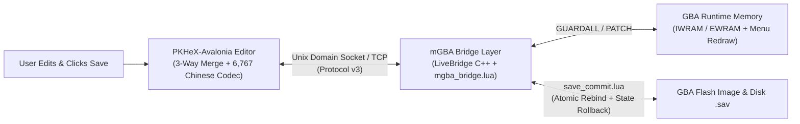

# PKHeX ⇄ mGBA Real-Time Live Bridge (`pkhex-mgba-live-bridge`)

[](./LICENSE)
[](#)

**[English](#english) | [中文说明](#中文说明)**

---

<a id="english"></a>

## English

A zero-friction, real-time bidirectional live bridge between **PKHeX-Avalonia** and **mGBA** on macOS (Apple Silicon) for **Pokémon Emerald** (including the 2011 double-byte Chinese 386 ROM hack, base ID `BPEE`).

Eliminates the traditional *"Save in-game → Export `.sav` → Edit in PKHeX → Overwrite `.sav` → Restart emulator"* loop, and fixes garbled Chinese text when editing double-byte localized Generation 3 saves in upstream PKHeX.

### ✨ Key Features

- **Zero-Config Live Connection (Source Preview Edition)**
  - Automatically launches or discovers running embedded `mGBA` sessions over private local Unix Domain Sockets.
  - Automatically loads live emulator snapshots (Trainer info, Bag, Party, PC Boxes, Event Flags) once the player enters the overworld, and refreshes clean fields in real time.
- **3-Way Semantic Field Merging**
  - Compares **Baseline**, **Editor Draft**, and **Live Emulator Snapshot** field by field.
  - Automatically tracks Emerald's dynamic XOR security key (`0xAC`), preserving live coordinates, battle HP/PP, and experience while applying item or money edits.
  - Tracks unique Pokémon identities (`PID + ID32`) across Party and Box slot swaps/moves in both the game and the editor.
  - Displays a 3-way conflict resolution dialog (**Baseline / Live Game Value / Edited Value**) when both sides modify the same field concurrently.
- **Atomic RAM + Flash + Disk Save Commit & Rollback**
  - Validates preconditions (`GUARDALL` + RAM save counter `0x03006200` + full Flash snapshot + disk bytes) inside a single synchronous mGBA core callback.
  - Atomically rebinds mGBA's save backend via `loadSaveFile` and renames the staged file into place. Supports lossless rollback (restoring both the deferred-write Flash mask and Flash bank state) even when savestates cause in-memory Flash to diverge from disk.
- **6,767-Character Double-Byte Chinese Codec**
  - Includes the complete 6,767-character mapping table ([`ChineseMap.tsv`](./src/tools/ChineseCompat/ChineseMap.tsv)) and encoder/decoder ([`ChineseCodec.cs`](./src/tools/ChineseCompat/ChineseCodec.cs)) for trainer names, Pokémon nicknames, mixed ASCII/Chinese text, and strict byte-length boundary checks.
- **In-Game Menu Quantity Live Redraw**
  - When browsing the Bag in-game, changing non-zero quantities of existing items schedules the game's native `RedrawListMenu` task via `gTasks` to update numbers on screen immediately without closing and reopening the Bag.

### 🏗️ Architecture



### 📂 Repository Structure

```text
.
├── bridge.py                     # Standalone Python live bridge daemon
├── mgba_bridge.lua               # mGBA Protocol v3 sync, snapshot & menu redraw script
├── save_commit.lua               # mGBA atomic Flash/disk backend rebind & rollback module
├── start_live_bridge.command     # One-click launcher for standalone mode
├── USER_GUIDE.md                 # Bilingual User Guide & consistency protection notes
├── ARCHITECTURE.md               # Bilingual Technical Architecture & A01-A24 acceptance matrix
├── test_bridge.py                # Python merge, encryption, version guard & draft isolation tests
├── test_protocol.py              # Lua 5.4 VM Protocol v3, idempotency, timeline & redraw tests
├── test_save_commit.py           # Coordinated Flash/disk commit & rollback failure tests
├── test_mgba_socket.py           # mGBA arm64 native socket close idempotency & EOF patch tests
└── src/                          # C# / C++ source integration, build scripts & test suites
    ├── BridgeEngine.cs           # Save parser, Pokémon crypto, semantic patch planner & RPC client
    ├── BridgeModule.cs           # Avalonia bridge panel & central save interception hook
    ├── LiveWorkspace.cs          # Live session manager, cross-process save lease & recovery
    ├── LiveMerge.cs              # 3-way field merge, Pokémon identity tracking & save image encoder
    ├── SaveCommitCoordinator.cs  # Coordinated save transaction journal & race window protection
    ├── NativeDiscovery.cs        # Local emulator session auto-discovery
    ├── build_source.py           # Full source build for PKHeX Live Preview app + embedded mGBA
    ├── build_integrated.py       # Binary-patched integrated build for PKHeX Chinese Compat app
    ├── README.md                 # Bilingual build & verification instructions
    ├── tools/
    │   ├── fetch_sources.py      # Fetches & verifies upstream PKHeX-Avalonia and mGBA Git blobs
    │   ├── ChineseCompat/        # 6,767-char double-byte Chinese codec & mapping table
    │   ├── SourceEditor/         # PKHeX-Avalonia live workspace & ViewModel integration
    │   ├── MgbaBridge/           # mGBA Qt/C++ native Unix Socket & lifecycle integration
    │   ├── MgbaSocketFix/        # mGBA 0.10.5 arm64 native socket close/EOF binary patcher
    │   └── Patcher/              # Mono.Cecil assembly & single-file bundle patcher
    └── tests/                    # C# unit regressions, frontend xUnit tests & mGBA fault injection
```

### 🚀 Quick Start

#### Option 1: Build the Full Source Preview App (Recommended)

1. **Prerequisites (macOS Apple Silicon)**
   - .NET 10.0 SDK
   - CMake, Qt 5 (`brew install qt@5`), Lua 5.4 (`brew install lua`)
   - Xcode Command Line Tools

2. **Fetch and Verify Pinned Upstream Sources**
   ```bash
   python3 src/tools/fetch_sources.py PKHeX-Avalonia
   python3 src/tools/fetch_sources.py mgba
   ```
   > `fetch_sources.py` downloads pinned `PKHeX-Avalonia (v1.101.2)` and `mGBA (0.10.5)` trees and verifies the Git blob SHA-1 of every file.

3. **Build, Bundle, and Sign**
   ```bash
   cd /tmp
   python3 /path/to/pkhex-mgba-live-bridge/src/build_source.py --output-root "$HOME/Library/Caches/PKHeXBridgeBuilds"
   ```
   The build produces a strictly signed `PKHeX实时版预览.app` (with `mGBA实时版.app` embedded) verified against all 6,767 Chinese character mappings.

#### Option 2: Run the Standalone Python Bridge

```bash
python3 bridge.py --rom "/path/to/Emerald.gba" --save "/path/to/Emerald.sav"
```
1. Open the `.gba` ROM in `mGBA` and load into the overworld.
2. Open `mGBA` **Tools → Scripting**, paste the `dofile(...)` line printed in the terminal, and click **Run**.
3. Open the same `.sav` file in `PKHeX`, edit, apply, and click **Save** to sync changes directly into emulator memory.

### 🧪 Running Automated Tests

This repository includes a built-in synthetic Emerald save generator—**no external ROM or `.sav` file is required** to run the regression suites:

```bash
# 1. Python & Lua Protocol / Rollback Regressions (52 tests)
python3 -m venv .test-venv
.test-venv/bin/python -m pip install -r src/tests/requirements.txt
.test-venv/bin/python -m unittest test_bridge.py test_protocol.py test_save_commit.py -v

# 2. C# Bridge, 3-Way Merge & Coordinated Save Regressions
dotnet run --project src/tests/native/check.csproj -c Release
```

### 📄 License & Acknowledgements

Licensed under the **[GNU General Public License v3.0 (GPL-3.0)](./LICENSE)**.

- **[PKHeX](https://github.com/kwsch/PKHeX)** & **[PKHeX-Avalonia](https://github.com/realgarit/PKHeX-Avalonia)** (GPL-3.0)
- **[mGBA](https://github.com/mgba-emu/mgba)** (MPL-2.0)
- **[PokemonMemHack](https://github.com/Fuzzier/PokemonHackSourceCode)** (GPL-3.0, referenced for Generation 3 memory layout and encryption structures)

> **Disclaimer**: This repository contains only bridge, codec, and test source code. **No copyrighted game ROMs or personal save files are included or distributed.** Use this software only with legally obtained game backups.

---

<a id="中文说明"></a>

## 中文说明

面向 macOS（Apple Silicon）打造的 **《宝可梦 绿宝石》（含 2011 经典双字节 386 汉化版，底本 `BPEE`）PKHeX-Avalonia ⇄ mGBA 实时双向无感修改器系统**。

告别传统修改器“游戏内保存 → 导出 `.sav` → 打开修改器 → 保存覆盖 → 重启游戏读档”的繁琐流程，以及原版 PKHeX 打开中文汉化版存档时的姓名乱码问题。

### ✨ 核心特性

- **零额外操作无感连接（源码实时预览版）**
  - 启动应用后自动拉起或发现正在运行的内置 `mGBA` 会话，通过本机私有 Unix Domain Socket 建立低延迟连接。
  - 进入游戏地图后自动读取实时运行快照（人物、背包、队伍、电脑箱子、事件标记），干净字段随游戏进程自动刷新。
- **三方字段级智能合并（3-Way Semantic Merge）**
  - 基于**编辑基准（Baseline）**、**编辑器草稿（Draft）**与**模拟器实时快照（Live）**进行逐字段三方合并。
  - 自动跟随绿宝石动态 XOR 加密密钥（`0xAC`），编辑背包或金钱的同时保留游戏中的实时坐标、步数、战斗后剩余 HP/PP 与经验值。
  - 支持队伍与电脑箱子内宝可梦跨槽位移动/交换时的唯一身份（`PID + ID32`）追踪。
  - 当游戏与修改器同时修改了同一字段时，弹出三方冲突解决窗口（展示**原值 / 游戏值 / 编辑值**供选择）。
- **RAM + Flash + 磁盘存档原子协调提交与回滚**
  - 保存时在同一模拟器核心同步回调内完成前置条件校验（`GUARDALL` + 保存计数 `0x03006200` + 完整 Flash 快照 + 磁盘镜像）。
  - 通过 `loadSaveFile` 原子切换模拟器存档后端并重命名落盘，支持即时存档（Savestate）下内存 Flash 与磁盘不一致场景的无损失败回滚（自动恢复 Flash 掩码与 Bank 状态）。
- **6,767 字双字节中文汉化字库兼容**
  - 内置完整双字节中文字表（[`ChineseMap.tsv`](./src/tools/ChineseCompat/ChineseMap.tsv)）与编解码器（[`ChineseCodec.cs`](./src/tools/ChineseCompat/ChineseCodec.cs)），完美支持中文训练家名、宝可梦昵称、中英混排与字节容量边界检查。
- **游戏内菜单即时重绘**
  - 在游戏内打开背包浏览时，修改已有道具的非零数量会通过游戏原生 `gTasks` 调度 `RedrawListMenu` 实时刷新画面数字，无需反复开关背包。

### 🚀 快速开始

#### 方式一：从源码完整构建「PKHeX 实时版预览.app」（推荐）

1. **拉取并校验上游源码**
   ```bash
   python3 src/tools/fetch_sources.py PKHeX-Avalonia
   python3 src/tools/fetch_sources.py mgba
   ```
2. **一键编译、打包并签名**
   ```bash
   cd /tmp
   python3 /完整路径/pkhex-mgba-live-bridge/src/build_source.py --output-root "$HOME/Library/Caches/PKHeXBridgeBuilds"
   ```

#### 方式二：运行自动化测试（无需外部 ROM 或存档）

```bash
# 1. 运行 Python 与 Lua 协议/回滚回归测试（52 项）
python3 -m venv .test-venv
.test-venv/bin/python -m pip install -r src/tests/requirements.txt
.test-venv/bin/python -m unittest test_bridge.py test_protocol.py test_save_commit.py -v

# 2. 运行 C# 桥接、三方合并与协调保存回归测试
dotnet run --project src/tests/native/check.csproj -c Release
```

详细使用说明请参阅 [USER_GUIDE.md](./USER_GUIDE.md)，技术架构与验收矩阵请参阅 [ARCHITECTURE.md](./ARCHITECTURE.md)，构建与测试细节请参阅 [src/README.md](./src/README.md)。
